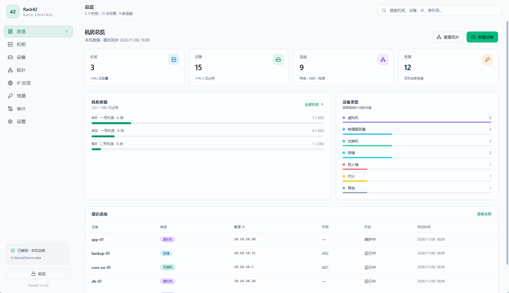
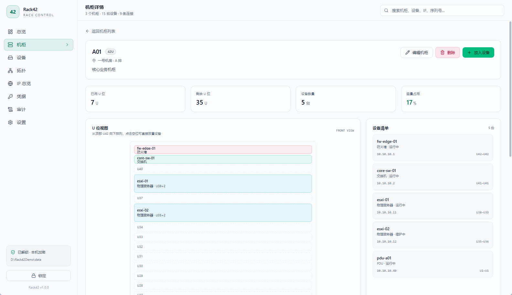
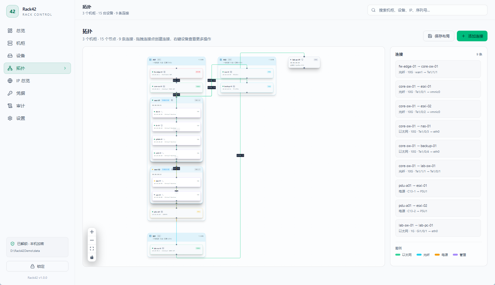
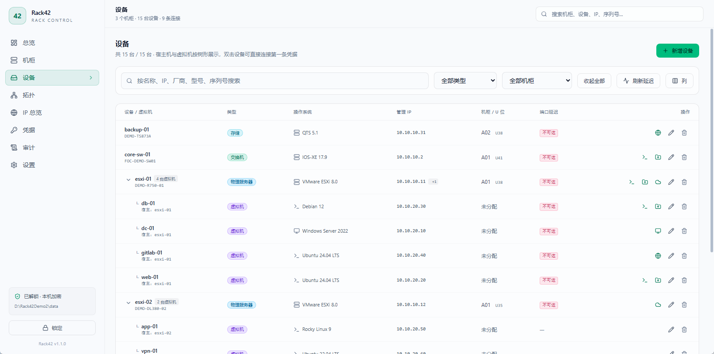
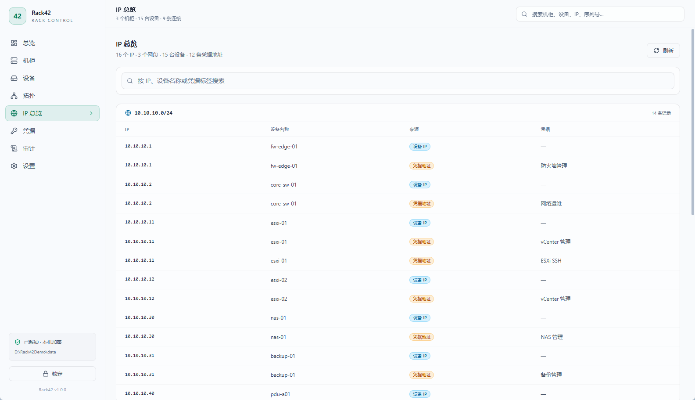
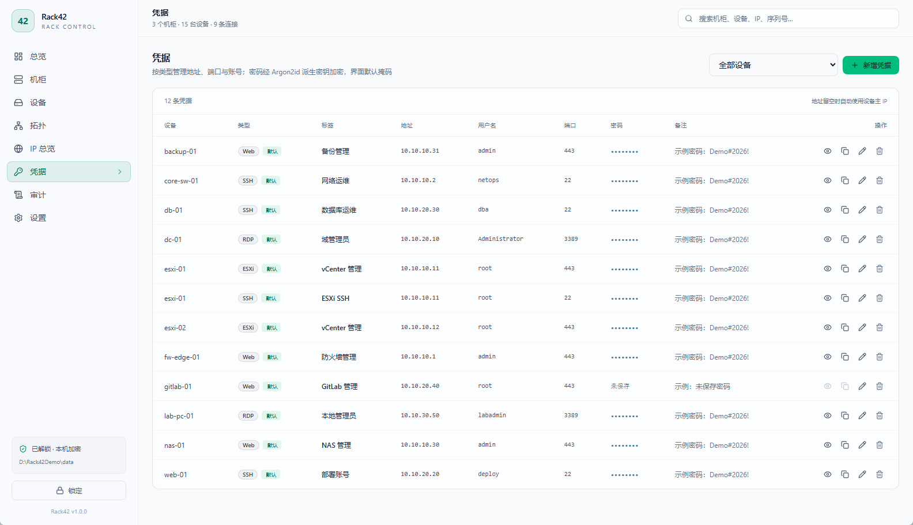
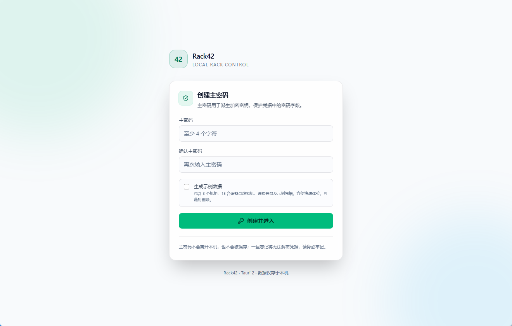

# Rack42

> 面向中小机房的 Windows 桌面端基础设施管理工具 —— 可视化机架、记录设备信息与连接关系、本地加密存储凭据。

[](https://tauri.app)
[](https://vuejs.org)
[](https://www.rust-lang.org)
[](#环境要求)
[](#license)
[](https://www.deepseek.com)

<p align="center">
  
  <br />
  <sub>角色形象：上善无形（原作）· ZipZipPipe（女仆二次设计）· 图片来自 <a href="https://github.com/EDMOK/blue-fish-archive">EDMOK/blue-fish-archive</a> · <a href="assets/deepseek-xiao-fei-yu-tai-bang.LICENSE.txt">CC BY-NC-SA 4.0</a> · 非官方同人</sub>
</p>

---

## 简介

Rack42 是一个基于 [Tauri 2](https://tauri.app) 构建的机房管理桌面应用。它把机房的物理与逻辑资产集中到一个本地应用中：

- **机架可视化**：以 U 位视图展示机柜内设备的占用情况，支持前/后视图与容量统计。
- **设备资产台账**：物理服务器、虚拟化服务器（VM）、路由器、交换机等，记录名称、管理 IP（可多个）、型号、序列号、厂商、所属机架与 U 位。
- **关系拓扑**：机柜 → 设备 → 虚拟机的归属关系与设备之间的物理连线（网线/光纤/电源），以交互式拓扑图呈现。
- **凭据安全存储**：用户名/密码本地加密保存，不落明文，不依赖云端。

Rack42 面向单机或小团队使用场景，数据完全保存在本机，适合无法接入云服务、对凭据可控性有要求的机房运维环境。

---

## 界面预览

<table>
  <tr>
    <td width="50%"><strong>总览</strong><br /></td>
    <td width="50%"><strong>机柜 U 位视图</strong><br /></td>
  </tr>
  <tr>
    <td width="50%"><strong>关系拓扑</strong><br /></td>
    <td width="50%"><strong>设备列表</strong><br /></td>
  </tr>
  <tr>
    <td width="50%"><strong>IP 总览</strong><br /></td>
    <td width="50%"><strong>凭据管理</strong><br /></td>
  </tr>
</table>

> 截图由首次启动时的「生成示例数据」生成；示例 IP 为演示地址。

---

## 功能特性

### 已规划 / 核心功能

- [x] 机柜与 U 位管理（新增、编辑、移动设备、容量热力图）
- [x] 多类型设备建模：物理服务器、虚拟机、路由器、交换机、防火墙、存储、PDU
- [x] 设备详情：名称、管理 IP（可多个，首个为主）、型号、序列号、厂商、操作系统（Windows / Linux / 其他）、状态
- [x] 凭据管理：类型（RDP / SSH / iDRAC / ESXi / Web / 其他）、地址、端口、用户名、密码（加密存储）、备注，支持多凭据绑定同一设备
- [x] 凭据总览：凭据页默认列出全部设备的凭据（带所属设备列），可按设备筛选；新增时可选择目标设备
- [x] 设备列表快捷连接：按凭据类型启动 RDP（临时 `.rdp` + DPAPI，密码不进命令行，窗口标题显示「设备名-IP」）或打开 Web 管理页
- [x] SSH/SFTP 快捷连接：支持 Xshell/Xftp 7.x、PuTTY/psftp、Windows OpenSSH；默认不把密码放入命令行；点击连接时密码自动复制到剪贴板，10 秒后清除
- [x] 设备内凭据管理：编辑设备时管理凭据、默认凭据、跟随主 IP；同类型多凭据可弹出选择
- [x] 新建设备时可直接录入多条凭据，点击「创建设备」与设备一并保存
- [x] 设备列表树形展示：宿主机下嵌套显示其虚拟机，可折叠/展开，搜索时自动展开命中项
- [x] 设备列表默认隐藏「状态」「厂商 / 型号」列，可通过工具栏「列」按需显示（本地记忆）
- [x] 设备列表右键菜单：连接、管理凭据、编辑、删除、为物理服务器添加虚拟机
- [x] 设备列表连接按钮使用凭据类型图标（含自定义上传图标）；同一类型含多个动作（SSH/SFTP）时使用动作图标区分
- [x] 端口延迟探测：包含凭据的设备自动探测凭据端口（TCP，1.5 秒超时），列表显示最小延迟，悬停查看每个端口的结果
- [x] 操作系统分类：设置中可新增/编辑分类、选择图标、维护具体系统列表；设备列表与拓扑显示分类图标
- [x] IP 总览：按网段（IPv4 /24、IPv6 /64）汇总设备管理 IP 与凭据地址，可搜索
- [x] 凭据类型管理：自定义类型、动作、默认端口、内置图标与 PNG/JPEG/WebP 自定义图标
- [x] 连接审计：记录 RDP/Web/SSH/SFTP 的动作、设备、凭据、目标与结果，不记录密码或用户名
- [x] 连接关系：设备间线缆连接（类型、速率、端口），VM 与宿主机的归属关系
- [x] 交互式拓扑图（Vue Flow）：机柜容器、设备与虚拟机自动归位、拖拽连接点建连、右键机柜添加设备、右键物理机添加虚拟机、右键设备/连线菜单、点击连线高亮两端设备、按类型着色、布局保存
- [x] 虚拟机归属：拓扑中虚拟机嵌套显示在宿主机卡片内（仅一层，不支持嵌套虚拟化）
- [x] 机柜归属：拓扑中设备按机柜分组显示在机柜卡片内，未分配机柜的设备单独排列
- [x] 全局搜索：按名称 / IP / 机架 / 标签快速定位
- [x] 数据导出（JSON，默认脱敏）
- [x] 主题切换：深色 / 浅色 / 跟随系统
- [x] 首次启动可勾选「生成示例数据」，自动创建机柜、设备、虚拟机、连接与示例凭据，便于快速体验

### 后续迭代

- [ ] 数据导入（JSON）
- [ ] 设备批量导入模板
- [ ] 简单的连通性探测（ICMP / TCP 端口）
- [ ] 拓扑图导出为 PNG / SVG
- [ ] 多用户与只读模式（需切换为共享数据库后端）

---

## 技术栈

| 层级 | 选型 | 说明 |
|---|---|---|
| 桌面框架 | **Tauri 2.x** | 原生 `.exe` 交付，压缩包小、内存占用低 |
| 前端 | **Vue 3.5 + TypeScript + Vite** | 组合式 API（`<script setup>`），组件化与类型安全 |
| 路由 | **Vue Router 5** | 官方路由，按页面拆分代码 |
| 状态管理 | **Pinia 4** | Vue 官方状态管理，轻量、TS 友好 |
| UI 组件 | **Tailwind CSS 4 + 自定义组件** | 深色运维主题，无重型依赖 |
| 拓扑可视化 | **Vue Flow (`@vue-flow/core`)** | 节点-连线交互、自定义节点、自动布局 |
| 机架视图 | 自定义 CSS Grid | U 位精确控制 |
| 后端 | **Rust** | 业务逻辑、数据库、加密、文件 IO |
| 数据库 | **SQLite（本地单文件）** | 免安装；凭据字段加密存储 |
| 数据访问 | **sqlx**（异步 SQL 访问） | 通过 Tauri Command 暴露给前端 |
| 密码派生 | **Argon2id** | 主密码派生凭据加密密钥 |
| 凭据加密 | **XChaCha20-Poly1305** | 随机 nonce，密文以 base64 存库 |
| 密钥保管 | **仅内存**（锁定/退出即清除） | 主密码与密钥不落盘 |
| 打包 | **Tauri CLI + Compress-Archive** | 生成便携 exe 压缩包（不生成安装程序） |

> **为什么是 Tauri 而不是 WPF/Electron？** 拓扑图与机架视图用 Web 技术实现效率最高（Vue Flow / SVG），Tauri 提供原生 `.exe` 与 Rust 侧加密能力，同时避免了 Electron 的体积与内存开销。

---

## 架构概览

```text
WebView (Vue)
├── 机架视图         U 位占用与容量统计
├── 拓扑视图         Vue Flow 节点与连线
├── 设备台账         设备表单与详情
└── 设置             主密码、导出
        │
        │ Pinia Store
        ▼
Tauri IPC (invoke)
        │
        ▼
Rust Core
├── commands/        命令入口（#[tauri::command]）
├── repository/      sqlx 查询
├── crypto.rs        Argon2 + XChaCha20
└── rack42.db        SQLite 数据库
```

**分层原则**

- 前端**不直接**访问数据库，所有读写通过 Tauri Command。
- 敏感字段（密码、密钥）只在 Rust 侧解密，前端拿到的永远是掩码或按需短时明文。
- 数据模型与迁移脚本集中在 `src-tauri/migrations/`，使用 sqlx migrate 管理版本。

---

## 目录结构

```text
Rack42/
├── src/                          # 前端
│   ├── components/
│   │   ├── rack/                 # 机架 U 位视图与表单
│   │   ├── topology/             # Vue Flow 自定义节点
│   │   ├── device/               # 设备表单
│   │   └── ui/                   # Modal 等基础组件
│   ├── pages/                    # 总览、机柜、设备、拓扑、IP 总览、凭据、设置
│   ├── router/                   # Vue Router 路由表
│   ├── stores/                   # Pinia 全局状态
│   ├── lib/
│   │   ├── ipc.ts                # 统一封装 invoke 与错误
│   │   ├── types.ts              # 与 Rust 侧对应的类型
│   │   ├── os.ts                 # Windows / Linux / 其他 系统目录
│   │   └── format.ts             # 枚举标签与时间格式化
│   ├── App.vue                   # 锁屏 / 主界面切换
│   ├── main.ts                   # 应用入口（createApp）
│   └── style.css                 # Tailwind 4 与主题样式
├── src-tauri/
│   ├── src/
│   │   ├── main.rs
│   │   ├── lib.rs                # 应用初始化、命令注册
│   │   ├── db.rs                 # 数据目录、连接池与迁移
│   │   ├── state.rs              # AppState 与内存密钥
│   │   ├── crypto.rs             # Argon2id + XChaCha20-Poly1305
│   │   ├── error.rs              # 统一错误类型
│   │   ├── commands/             # #[tauri::command] 入口
│   │   ├── models/               # 结构体与序列化
│   │   ├── repository/           # sqlx 数据访问
│   │   └── tests.rs              # 加密与数据访问测试
│   ├── migrations/               # sqlx 迁移 SQL
│   ├── capabilities/             # Tauri 权限配置
│   ├── icons/
│   ├── Cargo.toml
│   ├── build.rs
│   └── tauri.conf.json
├── scripts/                      # 构建辅助脚本
├── package.json
├── tsconfig.json
├── vite.config.ts
├── index.html
├── LICENSE
└── README.md
```

---

## 环境要求

| 项目 | 要求 |
|---|---|
| 操作系统 | Windows 10 1903+ / Windows 11 |
| WebView2 | 运行时需存在（Win10/11 通常已预装；便携包不包含） |
| Node.js | ≥ 20 LTS |
| Rust | stable（通过 [rustup](https://rustup.rs) 安装） |
| MSVC | Visual Studio 2022 Build Tools，勾选「使用 C++ 的桌面开发」 |
| WebView2 SDK | 由 Tauri 构建流程自动处理 |

> 注意：Tauri 依赖系统 WebView2，**不支持 Windows 7 及以下**。请确认目标终端环境。

---

## 快速开始

```bash
# 1. 克隆仓库
git clone https://github.com/guxin0123/Rack42.git
cd Rack42

# 2. 安装前端依赖
npm install

# 3. 启动开发模式（自动编译 Rust 并打开窗口）
npm run tauri:dev

# 4. 仅前端调试（浏览器中运行，后端能力不可用）
npm run dev
```

> 首次 `tauri dev` 会编译 Rust 依赖，耗时较长（通常 3–10 分钟），之后增量编译会快很多。

> 首次启动需要设置主密码（至少 4 个字符）；它只用于加密凭据，忘记后无法解密。
> 首次启动还会询问是否使用便携模式：选「是」时数据保存在程序目录的 `data` 文件夹，
> 选「否」时保存在当前 Windows 用户的数据目录；部署时可用 `RACK42_PORTABLE=1/0` 跳过询问。
> 需要自定义位置时，可在启动前设置环境变量 `RACK42_DATA_DIR`；默认数据库位于
> `%LOCALAPPDATA%\com.guxin0123.rack42\rack42.db`。如果该目录不可写，启动器会依次回退到
> `%APPDATA%`、系统临时目录和程序目录下的 `data` 文件夹。

### 首次启动与示例数据

设置主密码时可以勾选「生成示例数据」，自动创建 3 个机柜、15 台设备/虚拟机、9 条连接与 12 条示例凭据，便于直接体验完整界面。



> 示例数据使用 `10.10.x.x` 演示地址，端口探测会显示不可达；示例凭据密码为 `Demo#2026!`，可随时删除或修改。

---

## 构建便携压缩包

```bash
npm run tauri:build
```

脚本会执行 `tauri build --no-bundle`，再把可执行文件、LICENSE 和一份使用说明打包为：

```
release/Rack42-<version>-windows-x64.zip
```

项目不生成 NSIS / MSI 安装包，也不需要下载 WiX/NSIS 工具链。解压后双击 `Rack42.exe` 即可运行；首次启动可选择便携模式，数据会保存在程序目录的 `data/` 下。

其他命令：

- `npm run tauri:build:exe`：只编译可执行文件（产物在 `src-tauri/target/release/`），不打包 zip；
- `npm run tauri:build:debug`：调试构建并生成 `release/Rack42-<version>-windows-x64-debug.zip`。

> WebView2 运行时需要系统已安装；Windows 10 1903+ / Windows 11 通常已预装。若面向干净系统分发，可在压缩包中附带 WebView2 安装程序并注明。

### 构建速度

| 场景 | 命令 | 实测耗时（i9-13900K，增量） |
|---|---|---|
| 前端/交互开发 | `npm run tauri:dev` | 修改前端热更新，不重新编译 Rust |
| 快速打包验证 | `npm run tauri:build:debug` | 约 19 秒 |
| 正式便携包 | `npm run tauri:build` | 约 58 秒 |

说明与建议：

- 最慢的是 release 编译：Tauri 会把 `dist/` 嵌入可执行文件，**前端改动也会让 `rack42` crate 重新编译**，这是打包耗时的主要原因。
- release profile 已使用 `lto = "thin"` + `codegen-units = 16`；相比原来的 `lto = true` + `codegen-units = 1`（约 2 分 16 秒），打包时间缩短到约 58 秒，产物略大（zip 约 3.4 MB）。需要极限体积时可临时改回 fat LTO。
- 不要频繁执行 `cargo clean`；只清理应用 crate 可用 `cargo clean -p rack42 --release`。
- 把项目目录、`%USERPROFILE%\.cargo`、`%LOCALAPPDATA%\tauri` 加入 Windows Defender 排除项，通常能明显加快 Rust 编译：
  ```powershell
  Add-MpPreference -ExclusionPath "D:\Code\Rack42"
  Add-MpPreference -ExclusionPath "$env:USERPROFILE\.cargo"
  ```
- 可选安装 sccache 缓存依赖编译：
  ```powershell
  cargo install sccache
  $env:RUSTC_WRAPPER = 'sccache'
  npm run tauri:build
  ```
- 只检查 Rust 编译错误时用 `npm run check:rust`（`cargo check`），比完整链接快很多。

---

## 数据模型（核心表）

```sql
-- 机柜
CREATE TABLE racks (
    id          INTEGER PRIMARY KEY,
    name        TEXT NOT NULL UNIQUE,   -- 如 "A01"
    location    TEXT,                   -- 机房/楼层
    total_u     INTEGER NOT NULL DEFAULT 42,
    note        TEXT
);

-- 设备（物理服务器 / VM / 路由器 / 交换机 / 其他）
CREATE TABLE devices (
    id            INTEGER PRIMARY KEY,
    name          TEXT NOT NULL,
    kind          TEXT NOT NULL,        -- physical_server | vm | router | switch | firewall | storage | pdu | other
    mgmt_ips      TEXT NOT NULL DEFAULT '[]', -- 管理 IP 的 JSON 数组，第一个为主 IP
    vendor        TEXT,
    model         TEXT,
    serial        TEXT,
    os            TEXT,                 -- 如 Windows Server 2022
    os_family     TEXT,                 -- windows | linux | other
    status        TEXT DEFAULT 'active',
    rack_id       INTEGER REFERENCES racks(id) ON DELETE SET NULL,
    rack_position INTEGER,              -- 起始 U 位（1 为底部）
    rack_height   INTEGER DEFAULT 1,    -- 占用 U 数
    host_id       INTEGER REFERENCES devices(id) ON DELETE SET NULL, -- VM 所属宿主机
    note          TEXT,
    created_at    TEXT DEFAULT (datetime('now')),
    updated_at    TEXT DEFAULT (datetime('now'))
);

-- 操作系统分类（设置中可编辑；devices.os_family 保存 slug）
CREATE TABLE os_families (
    id         INTEGER PRIMARY KEY AUTOINCREMENT,
    slug       TEXT NOT NULL UNIQUE,
    name       TEXT NOT NULL,
    icon       TEXT NOT NULL DEFAULT 'monitor',
    options    TEXT NOT NULL DEFAULT '[]',  -- JSON：具体系统列表
    is_builtin INTEGER NOT NULL DEFAULT 0,
    sort_order INTEGER NOT NULL DEFAULT 0
);

-- 凭据类型（内置 RDP / SSH / iDRAC / ESXi / Web / 其他）
CREATE TABLE credential_types (
    id           INTEGER PRIMARY KEY AUTOINCREMENT,
    slug         TEXT NOT NULL UNIQUE,
    name         TEXT NOT NULL,
    icon         TEXT NOT NULL DEFAULT 'key',
    actions      TEXT NOT NULL DEFAULT '[]', -- JSON: rdp | ssh | sftp | web
    default_port INTEGER,
    is_builtin   INTEGER NOT NULL DEFAULT 0,
    sort_order   INTEGER NOT NULL DEFAULT 0
);

-- 凭据（password 为应用层加密后的 base64 密文；地址为空时使用设备主 IP）
CREATE TABLE credentials (
    id          INTEGER PRIMARY KEY AUTOINCREMENT,
    device_id   INTEGER NOT NULL REFERENCES devices(id) ON DELETE CASCADE,
    type_id     INTEGER REFERENCES credential_types(id),
    label       TEXT,
    address     TEXT,
    port        INTEGER,
    username    TEXT,
    domain      TEXT,                   -- RDP 域，可选
    password    TEXT,                   -- XChaCha20-Poly1305 密文
    note        TEXT,
    is_default  INTEGER NOT NULL DEFAULT 0
);

-- 连接关系
CREATE TABLE links (
    id            INTEGER PRIMARY KEY,
    src_device_id INTEGER NOT NULL REFERENCES devices(id) ON DELETE CASCADE,
    src_port      TEXT,
    dst_device_id INTEGER NOT NULL REFERENCES devices(id) ON DELETE CASCADE,
    dst_port      TEXT,
    link_type     TEXT,                 -- ethernet | fiber | power | mgmt
    speed         TEXT,                 -- 1G / 10G / ...
    note          TEXT
);

-- RDP 临时会话（仅记录待清理的 .rdp 文件）
CREATE TABLE rdp_sessions (
    id         INTEGER PRIMARY KEY AUTOINCREMENT,
    target     TEXT NOT NULL,
    temp_path  TEXT NOT NULL,
    created_at TEXT NOT NULL DEFAULT (datetime('now'))
);

-- 连接审计（不记录密码或用户名）
CREATE TABLE audit_logs (
    id               INTEGER PRIMARY KEY AUTOINCREMENT,
    action           TEXT NOT NULL,
    device_id        INTEGER,
    device_name      TEXT,
    credential_id    INTEGER,
    credential_label TEXT,
    credential_type  TEXT,
    target           TEXT,
    result           TEXT NOT NULL,
    detail           TEXT,
    created_at       TEXT NOT NULL DEFAULT (datetime('now'))
);
```

拓扑图的节点位置（拖拽后的坐标）单独存放在 `topology_layout` 表中，按视图名保存，避免与业务数据耦合。机柜节点的位置保存在 `topology_rack_layout` 表中；机柜内的设备、宿主机内的虚拟机由父节点自动排布，位置随父节点推导，不单独落库。

`devices.host_id` 只允许指向 `physical_server` 类型的设备，且只有 `vm` 类型可以设置宿主机；后端拒绝自引用、嵌套虚拟化，宿主机类型变更时会自动解除其虚拟机的归属。

---

## 密码与密钥管理

Rack42 采用两层保护，全部在本机完成：

1. **主密码 → 加密密钥**：首次启动设置主密码，使用 Argon2id（内存 64 MiB、迭代 3 次、并行 4）派生 256-bit 密钥；数据库只保存随机 salt 与密钥指纹，用于解锁校验。
2. **凭据字段加密**：每条凭据的密码使用 XChaCha20-Poly1305 加密，随机 24 字节 nonce 与密文一并 base64 后存入 SQLite，没有主密码无法解密。

解锁期间密钥仅驻留内存，点击「锁定」或退出应用即清除。当前版本的数据库文件本身**未整库加密**（SQLCipher 列入后续加固项），机柜、设备等资产元数据以明文保存在本机数据库中。

### 约束与提醒

- 主密码不可找回，当前版本也未提供恢复码；忘记主密码后，已加密的凭据将无法解密。
- 前端只在点击「显示」时通过 `reveal_credential` 命令获取单条凭据明文，界面默认掩码。
- RDP 连接使用临时 `.rdp` 与 Windows DPAPI（`password 51:b:`）；临时文件在 mstsc 退出或下次启动时清理，密码不进入命令行，也不写入 Credential Manager。
- SSH/SFTP 默认只向客户端传主机、端口和用户名，由客户端弹窗询问密码；点击连接时会把该凭据密码复制到系统剪贴板并在 10 秒后自动清除（若期间剪贴板已被替换则不清除），方便直接粘贴。「自动填充密码到命令行」默认关闭，开启后 Xshell/PuTTY/Xftp/psftp 的密码会出现在子进程命令行，需自行承担风险。Windows OpenSSH 始终由控制台提示密码。
- 连接审计记录动作、设备、凭据标签、目标和结果，不记录密码或用户名；Web 目标会去掉路径和查询参数。
- Web 连接只调用系统 `shell32.dll` 的 `ShellExecuteW`（`open`），不再探测或兜底启动特定浏览器；打开结果取决于系统默认浏览器关联。
- 导出 JSON 默认脱敏，不包含密码、密钥或主密码哈希；请勿把数据库文件提交到版本库。
- 凭据的显示/复制操作尚未写入审计日志；当前审计范围仅连接动作。

---

## 开发约定

### 添加一个 Tauri 命令

```rust
// src-tauri/src/commands/device.rs
#[tauri::command]
pub async fn list_devices(
    state: tauri::State<'_, AppState>,
) -> Result<Vec<Device>, AppError> {
    repository::device::list(&state.db).await
}
```

```rust
// src-tauri/src/lib.rs
.invoke_handler(tauri::generate_handler![
    commands::device::list_devices,
    // ...
])
```

```ts
// src/lib/ipc.ts
export const listDevices = () => invoke<Device[]>('list_devices');
```

在组件中使用：

```vue
<!-- src/pages/DeviceList.vue -->
<script setup lang="ts">
import { onMounted, ref } from 'vue'

import { listDevices } from '@/lib/ipc'
import type { Device } from '@/lib/types'

const devices = ref<Device[]>([])

onMounted(async () => {
  devices.value = await listDevices()
})
</script>

<template>
  <ul>
    <li v-for="device in devices" :key="device.id">
      {{ device.name }}
    </li>
  </ul>
</template>
```

### 约定

- 所有命令返回 `Result<T, AppError>`，`AppError` 实现 `Serialize`，前端统一在 `ipc.ts` 中转换错误提示。
- 前端统一使用 `<script setup lang="ts">` 与组合式 API，组件文件用 PascalCase 命名（如 `RackView.vue`）。
- 类型定义在 Rust 与 TypeScript 两侧保持同名同字段；可考虑 `ts-rs` 自动生成 TS 类型。
- 数据迁移只增不改：每次 schema 变更新增一个 `migrations/000X_xxx.sql`。

---

## 代码规范

```bash
npm run typecheck     # vue-tsc --noEmit
npm run build         # 类型检查 + 前端产物
cargo fmt --check     # Rust 格式
cargo clippy -- -D warnings
cargo test --manifest-path src-tauri/Cargo.toml
```

---

## 打包与发布

| 项目 | 说明 |
|---|---|
| 应用标识 | `com.guxin0123.rack42`（在 `tauri.conf.json` 中修改） |
| 分发形式 | 便携 zip：`release/Rack42-<version>-windows-x64.zip`（exe + LICENSE + 使用说明），不含 README、素材与安装程序 |
| 签名 | 如需发布到公网，可对 exe 做代码签名以减少 SmartScreen 警告 |
| 更新 | 可选启用 `tauri-plugin-updater`，指向内网或自建静态更新源 |

`tauri.conf.json` 已关闭安装包构建：

```jsonc
{
  "bundle": {
    "active": false,
    "targets": []
  }
}
```

---

## 路线图

| 版本 | 目标 |
|---|---|
| v0.1 | 机柜 / 设备 CRUD、U 位视图、主密码与凭据加密 |
| v0.2 | 凭据管理、连接关系、Vue Flow 拓扑图 |
| v0.3 | 全局搜索、JSON 导出、拓扑布局持久化 |
| v0.4 | 连接审计（已完成）、连通性探测、SQLCipher 整库加密 |
| v1.0 | 便携包签名、自动更新、文档完善 |

---

## 常见问题

### Q：为什么不直接用 NetBox？

A：NetBox 功能更完整，但它是 Web 服务形态。若你的场景要求单机 `.exe`、数据不出本机、凭据由本地密钥保护，Rack42 更贴合。两者可并行：Rack42 做日常查看与凭据管理，NetBox 做长期台账。

### Q：Windows 7 能用吗？

A：不能。Tauri 依赖 WebView2，仅支持 Windows 10 1903 及以上。

### Q：多人同时使用怎么办？

A：当前设计为单机 SQLite。多人协作需要改为共享数据库（PostgreSQL）+ 服务端，属于后续演进方向，不在 v1.0 范围内。

### Q：忘记主密码怎么办？

A：无法解密已加密的凭据。当前版本没有恢复码机制，只能删除数据库后重建；这是加密设计的固有代价，请务必牢记主密码。

---

## 贡献

欢迎提交 Issue 与 PR。提交前请确保：

- `npm run typecheck` 通过；
- `cargo fmt && cargo clippy -- -D warnings` 通过；
- `cargo test` 通过；
- 涉及数据库变更时附带迁移脚本与说明。

---

## 致谢

- 本项目的代码与文档由 [DeepSeek](https://www.deepseek.com) 辅助开发。
- 角色形象「小肥鱼太棒了！」：原作 **上善无形**，女仆二次设计 **ZipZipPipe**，图片来自 [EDMOK/blue-fish-archive](https://github.com/EDMOK/blue-fish-archive)；按仓库说明依 [CC BY-NC-SA 4.0](https://creativecommons.org/licenses/by-nc-sa/4.0/) 使用，非 DeepSeek 官方形象。

---

## License

本项目采用 [MIT License](LICENSE) 开源，Copyright © 2026 guxin0123。

> 角色图片「小肥鱼太棒了！」为 [CC BY-NC-SA 4.0](https://creativecommons.org/licenses/by-nc-sa/4.0/) 同人素材，**不适用**上述 MIT 许可；其署名与许可见 [assets/deepseek-xiao-fei-yu-tai-bang.LICENSE.txt](assets/deepseek-xiao-fei-yu-tai-bang.LICENSE.txt)。

> **免责声明**：本工具用于记录与管理自有基础设施信息。请确保凭据的使用符合所在组织的安全策略，并定期备份数据库；忘记主密码将无法解密凭据。
